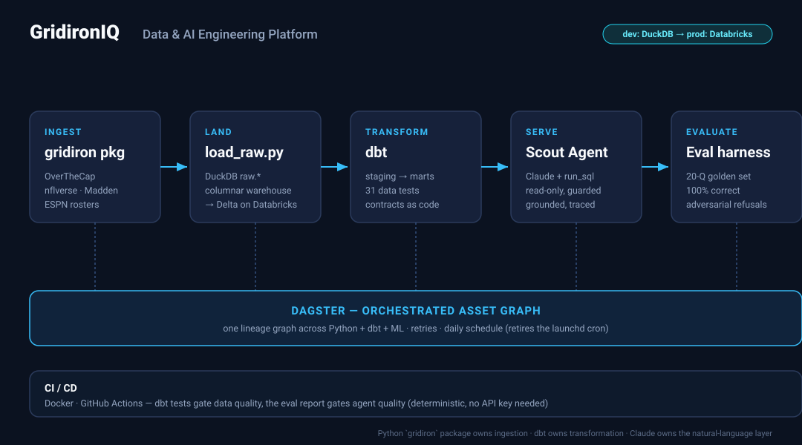
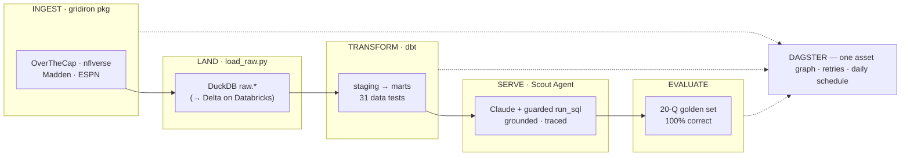

# GridironIQ — Architecture

An NFL salary-cap analytics platform, built as an end-to-end **data + AI
engineering** system. The Python `gridiron` package owns ingestion; **dbt** owns
transformation; **Dagster** orchestrates; **Claude** serves a natural-language
layer; an **eval harness** proves it's reliable.

## The pipeline

## Layers

| Layer | Directory | Tech | What it does |
|---|---|---|---|
| Ingestion | [`gridiron/`](gridiron/) | Python | Pulls & cleans cap/roster/Madden data (owns the OverTheCap data traps). |
| Warehouse | [`warehouse/`](warehouse/) | dbt + DuckDB | Landed raw → tested staging + marts. Engine-portable to Databricks. |
| Orchestration | [`orchestration/`](orchestration/) | Dagster | Unifies ingestion + dbt + ML in one lineage graph on a daily schedule. |
| Agent | [`gridiron/agent/`](gridiron/agent/) | Anthropic SDK | Natural-language questions → read-only SQL over the marts → grounded answers. |
| Evals | [`gridiron/evals/`](gridiron/evals/) | Python | Scores the agent on a golden set (correctness, groundedness, refusals). |
| CI/CD | [`.github/`](.github/) | Docker + Actions | dbt tests gate data quality; the eval report gates agent quality. |

## Two design decisions worth knowing

**dev DuckDB → prod Databricks.** All transformation is dbt, so the *same* models
run against a free local DuckDB during development and against Databricks
(Delta + Unity Catalog) in production — only the connection profile changes.

**Deterministic, free evals.** The agent's answers are graded in pure Python
(ground truth computed live from the warehouse; groundedness checked against the
retrieved rows), so the quality gate runs in CI with no API key and no data — the
last run's traces are persisted and re-scored. See [`gridiron/evals/`](gridiron/evals/README.md).
