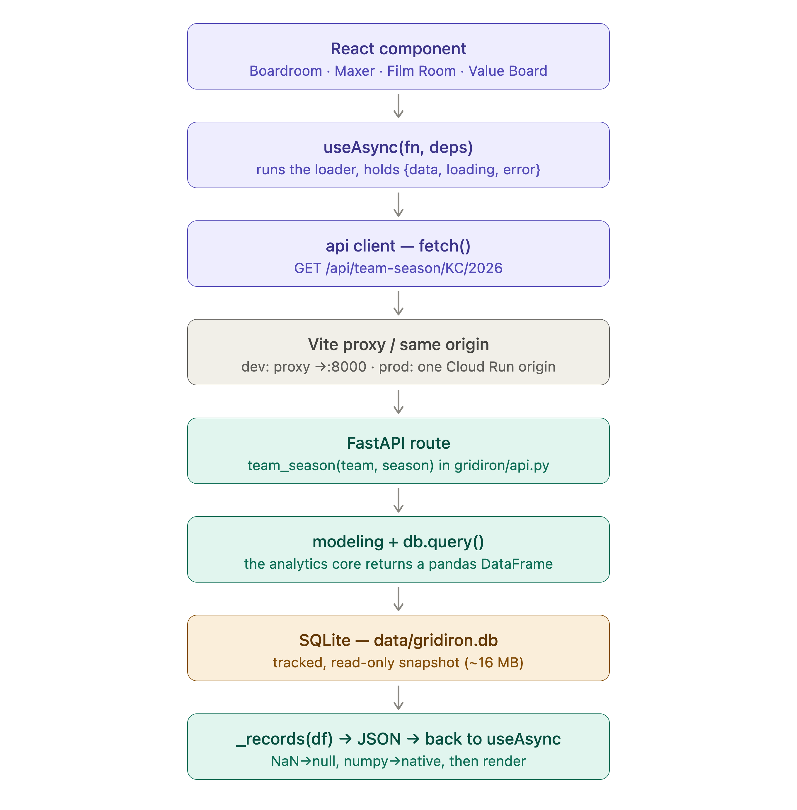

# 🏈 GridironIQ

> **In the salary cap era, which positions truly win championships, and are teams paying for them correctly?**

**Live:** [the app](https://gridironiq-vrxzqxauuq-uw.a.run.app) · [Tableau dashboard](https://public.tableau.com/app/profile/daejuan.graham/viz/GridironIQNFLRosterConstruction/Dashboard1)

GridironIQ is a full-stack NFL analytics platform built around that one question.
It models salary-cap data back to 1994 as **share of the cap** rather than raw
dollars, correlates positional spending with Super Bowl outcomes, and uses machine
learning to find the roster-construction profiles that win. It then applies those
findings to today's rosters, contracts, and games.

| Section | What it answers |
|---|---|
| **Boardroom** | Where the money goes, and whether it buys rings. Positional cap shares by team and season, the champion premium, a per-position efficiency verdict, team-vs-team comparison, and k-means roster archetypes. |
| **Film Room** | Why a team lost, or who has the edge next. Completed games get a play-by-play breakdown with player attribution, by-quarter subtotals, and a per-play EPA log. Upcoming games get a matchup preview. Claude writes the report. |
| **Super Bowl Maxer** | How far a current roster is from a champion's. Readiness score, league rank, ranked needs, projected starters, free-agent and trade targets, and a simulator that recomputes the outlook after signings and trades. Refreshed daily. |
| **Value Board** | The best and worst contracts in football: each player's caliber percentile against his pay percentile at his position. |

**Contents:** [Findings](#what-the-data-says) · [How it works](#how-it-works) ·
[Quickstart](#quickstart) · [Repository layout](#repository-layout) ·
[Data and methodology](#data-and-methodology) · [Film Room](#film-room) ·
[Super Bowl Maxer](#super-bowl-maxer-methodology) · [Value Board](#value-board) ·
[Data and AI platform](#data-and-ai-engineering-platform) ·
[Deploy](#deploy-to-gcp-cloud-run) · [Known limits](#known-limits)

---

## What the data says

Computed by this pipeline over **2011–2024**, the window where the contract source
is comprehensive (see [Data and methodology](#data-and-methodology)): 446
team-seasons and 14 champions. Shares are *normalized* (a position's slice of the
cap a team has accounted for), so seasons with different coverage stay comparable.
Figures are from the November 2026 data snapshot.

**Champion premium** is the Super Bowl winner's average share minus the league
average, by position, in percentage points of the cap:

| Verdict | Positions | Read |
|---|---|---|
| **Worth paying up**: champions over-index and spend tracks winning | TE, QB, EDGE, T, S | Tight end is the strongest single signal. Champions spend 2.4 points more than the league there, and its correlation with winning is the highest of any position (about 0.15). QB (+1.8) and edge rusher (+1.2) follow. |
| **Fairly paid** | WR, IDL, specialists | Within a third of a point of league average either way. |
| **Overpaid leaguewide**: champions under-index and the correlation is negative | CB, LB, C, RB, G | Champions spend 2.2 points less than the league at corner, 1.4 less at linebacker and at center, and 1.1 less at running back. |

**Winning archetypes.** K-means (k=5) on standardized spending profiles, each
cluster named for the two positions it invests in most above league average. The
"TE + SPEC" build has the highest title rate, 5.8% of its 103 team-seasons, ahead
of "QB + G" at 4.9%. "IDL + CB" (1.0%), "C + LB" (1.2%), and "RB + EDGE" (1.6%)
win least.

**Predicting the Super Bowl** from the positional-spending profile alone: a random
forest reaches a cross-validated ROC-AUC of **0.73 (±0.16 across five folds) for
Super Bowl wins**, with TE and WR cap share the most important features by
permutation importance. The same model does not predict Super Bowl *appearances*
(AUC 0.41, below chance), which is a fair measure of how thin the signal is.

> These are directional findings from a hard problem. Fourteen champions is a
> small sample, so read them as signals. They are reproducible from the committed
> database:
>
> ```bash
> python -m gridiron.modeling.cap_efficiency   # champion premium + verdicts
> python -m gridiron.modeling.clustering       # roster archetypes
> python -m gridiron.modeling.ml_pipeline      # Super Bowl model + importances
> ```

---

## How it works

```
ingestion (network) ──► data/gridiron.db ──► gridiron/api.py ──► frontend/ (React)
gridiron/ingestion       SQLite, tracked      FastAPI, /api/*  └► app/streamlit_app.py
```

- **Analytics are precomputed.** Two scripts run ingestion and modeling and persist
  the results as SQLite tables. The API reads those tables and only does light
  per-request work (team reports, the trade board, roster simulation). A modeling
  change shows up in the app after the refresh script is rerun.
- **The Film Room is the exception.** Schedules and play-by-play are fetched from
  nflverse on demand and cached (play-by-play for an hour), so the first request
  for a season is slow and needs network access.
- **One container in production.** The FastAPI app serves the built React bundle,
  so the deployed app is a single origin on Cloud Run. In development Vite proxies
  `/api` to the API.
- **The data refreshes itself.** A GitHub Actions schedule rebuilds the database
  every day at 13:00 UTC, commits `data/gridiron.db` to `main`, and triggers a
  deploy. Signings, trades, and cuts reach the live app within a day.
- **Two frontends.** The React app is what Cloud Run serves. The Streamlit app is
  the original frontend and calls the `gridiron` package directly.

A request from click to render:



The API contract is documented in [`frontend/README.md`](frontend/README.md).

---

## Quickstart

Requires Python 3.10+ (3.11 is the tested target; [`uv`](https://github.com/astral-sh/uv)
recommended) and Node 20 for the React app. The repository ships a prebuilt
`data/gridiron.db`, so the app runs without downloading any cap or roster data.

```bash
uv venv --python 3.11 .venv
source .venv/bin/activate
uv pip install -e ".[dev]"     # deps + the gridiron package (editable) + pytest/ruff
cp .env.example .env           # optional: set ANTHROPIC_API_KEY
```

`ANTHROPIC_API_KEY` is only needed for the Film Room's written report and the
scouting agent. Everything else works without it. If you skip the editable
install, prefix the Python commands below with `PYTHONPATH=.`.

**React app (development, two processes).** Vite on `:5173` proxies `/api` to the
API on `:8000`.

```bash
python -m uvicorn gridiron.api:app --reload --port 8000
```

```bash
npm --prefix frontend install && npm --prefix frontend run dev
```

**Production shape (one origin).** The API serves the built SPA at `:8000`.

```bash
npm --prefix frontend run build && python -m uvicorn gridiron.api:app --port 8000
```

**Streamlit app** (`:8501`):

```bash
streamlit run app/streamlit_app.py
```

**Rebuild the data layer.** Both scripts hit live sources and rewrite
`data/gridiron.db`. The cap ETL must run first because the Maxer reuses the
Boardroom's position weights.

```bash
python scripts/run_cap_etl.py              # Boardroom: contracts → positional spending
python scripts/refresh_rosters.py --force  # Maxer: rosters, talent, free agents, value board
```

**Film Room from the command line:**

```bash
python scripts/run_filmroom.py 2025_22_SEA_NE --payload-only   # metrics only, no API call
python scripts/run_filmroom.py --season 2026 --week 1          # a whole week of reports
```

**Checks.** These are what CI runs on every pull request, plus `dbt parse` for the
warehouse. The frontend's only check is `npm --prefix frontend run build`.

```bash
pytest -q
ruff check gridiron/agent gridiron/evals orchestration \
  warehouse/load_raw.py warehouse/load_delta.py warehouse/build.py tests
python -m gridiron.evals.harness --rescore --min-pass 0.9 --min-grounded 0.9
```

---

## Repository layout

```
gridironIQ/
├── gridiron/                   # the Python package
│   ├── config.py               # paths, season constants, eras, league cap table, model id
│   ├── db.py                   # SQLite access layer (SQLAlchemy)
│   ├── api.py                  # FastAPI JSON API; also serves the built SPA
│   ├── ingestion/
│   │   ├── reference.py        # teams, position groups, divisions, Super Bowl results
│   │   ├── cap_data.py         # contracts → positional spending shares
│   │   ├── load_cap.py         # cap ETL → SQLite
│   │   ├── rosters.py          # live rosters, Madden/AV grades, in-season signals
│   │   ├── espn_roster.py      # ESPN cross-check and roster auto-fill
│   │   ├── buzz.py             # award-market "buzz" signal
│   │   └── schedules.py        # full game slate, played and scheduled
│   ├── modeling/
│   │   ├── cap_efficiency.py   # champion premium, spend/success correlation, verdicts
│   │   ├── ml_pipeline.py      # Super Bowl classifier (CV + permutation importance)
│   │   ├── clustering.py       # k-means roster archetypes
│   │   ├── roster_strength.py  # player talent → unit strength per team and position
│   │   ├── organization.py     # franchise track-record score
│   │   ├── sb_maxer.py         # champion blueprint, readiness, outlook, needs
│   │   ├── free_agents.py      # best available free agents per need
│   │   ├── trade_market.py     # trade cost in draft-pick terms
│   │   ├── value_board.py      # caliber vs. pay percentile per player
│   │   ├── player_value.py     # learned in-season production forecast (offense)
│   │   └── defense_value.py    # the same for defenders
│   ├── filmroom/
│   │   ├── pbp_metrics.py      # play-by-play → metrics, attribution, team form
│   │   ├── matchup.py          # pre-game preview payloads
│   │   └── breakdown.py        # the Claude-written report, pre and post game
│   ├── agent/                  # natural-language scouting agent over the dbt marts
│   └── evals/                  # deterministic eval harness + 20-question golden set
├── frontend/                   # React + Vite app (what Cloud Run serves)
├── app/streamlit_app.py        # the original Streamlit frontend
├── sql/                        # 01_schema.sql (tables), 02_views.sql (views + indexes)
├── scripts/                    # run_cap_etl, refresh_rosters, crosscheck_rosters,
│                               # run_filmroom, train_player_value
├── data/gridiron.db            # tracked SQLite snapshot; the rest of data/ is git-ignored
├── notebooks/                  # 01_cap_eda, 02_model_results
├── warehouse/                  # dbt project (DuckDB dev → Databricks prod)
├── lakehouse/                  # PySpark + Delta medallion for play-by-play
├── orchestration/              # Dagster asset graph
├── tableau/                    # dashboard data export + build guide
├── tests/                      # pytest: SQL guard + eval scorer
├── Dockerfile.web, cloudbuild.yaml   # the deployed web image and its Cloud Build config
├── Dockerfile, docker-compose.yml    # the platform (Dagster) image
└── .github/workflows/          # ci.yml, daily-refresh.yml, deploy.yml
```

More detail lives next to the code: [`ARCHITECTURE.md`](ARCHITECTURE.md),
[`DATABRICKS.md`](DATABRICKS.md), and the READMEs in [`frontend/`](frontend/README.md),
[`warehouse/`](warehouse/README.md), [`lakehouse/`](lakehouse/README.md),
[`orchestration/`](orchestration/README.md), [`gridiron/agent/`](gridiron/agent/README.md),
[`gridiron/evals/`](gridiron/evals/README.md), and [`tableau/`](tableau/README.md).

---

## Data and methodology

**Sources.** Contract and cap data come from the
[nflverse](https://github.com/nflverse/nflverse-data) `historical_contracts`
release, which is sourced from [OverTheCap](https://overthecap.com). Play-by-play
comes from the nflverse `pbp` release (nflfastR), and the schedule from `nfldata`.
All are read as versioned release assets, with no scraping and no heavyweight
client library.

**Cap share, not dollars.** Every comparison is a position's cap charge as a
fraction of the cap, so 1995 and 2024 sit on the same axis. The ETL takes each
contract-year's own `cap_percent` and cross-checks it against
`dollars / league_cap`.

**Governing-contract de-duplication.** `historical_contracts` stores every deal a
player ever signed, each projecting a full multi-year cap schedule, so an extension
and the deal it replaced both carry the overlap years. Each player-season is
attributed to the **most recently signed contract in effect** that season. Without
this, modern-era spend inflates to more than 400% of the cap.

**Position groups.** One taxonomy is used everywhere: QB, RB, WR, TE, T, G, C,
IDL, EDGE, LB, CB, S, and SPEC, with OL as a fallback label for linemen whose
role is unknown. It is defined in `gridiron/ingestion/reference.py`, mirrored in
the frontend, and pinned by dbt tests.

**Era segmentation.** Structural breaks are flagged as milestones and used to
bucket every season:

- **1994**: salary cap introduced (start of the analysis window)
- **2004**: defensive-contact rule emphasis (illegal contact, defensive holding)
- **2011**: CBA (rookie wage scale, restructured cap mechanics)
- **2021**: 17-game regular season

**Historical coverage.** From 2011 onward the source captures about 79% of each
team's cap on average (the remainder is dead money and minimum deals). Before
2011 it typically captures under a third, so pre-2011 positional distributions
are directional at best. Modeling defaults to 2011–2024, and the normalized share
keeps eras comparable.
The 2011 CBA happens to be both a rule milestone and the data-quality boundary.

**Forward seasons.** Contracts commit cap dollars years ahead, so the database
carries committed-cap shares through five league years past the current one.
Anything that correlates spending with winning stops at the last finalized Super
Bowl.

### The cap ETL

`scripts/run_cap_etl.py` calls `gridiron.ingestion.load_cap.run_etl()`, which is
idempotent: each run drops and rebuilds every Boardroom table.

```
download_contracts               nflverse historical_contracts  → data/raw/*.parquet
└─ build_player_year_caps        explode nested per-year cap detail → 1 row / player / season
   └─ _select_governing_contract de-duplicate overlapping deals
      └─ build_positional_spending aggregate + normalize → team × season × position
         └─ build_spending_features pivot wide → model-ready matrix
            └─ load to SQLite (schema → tables → views)
```

### Data model (SQLite)

| Table or view | Grain | Notes |
|---|---|---|
| `league_cap` | season | League cap, era, and milestone (the share denominator) |
| `super_bowls`, `team_outcomes` | season, team-season | Super Bowl participants and the `sb_appearance` / `sb_win` targets |
| `player_year_caps` | player-season | Exploded, de-duplicated cap charges |
| `positional_spending` | team-season-position | `cap_pct`, `cap_pct_norm`, dollars, player counts |
| `spending_features` | team-season | Wide `pct_<POS>` matrix for modeling |
| `v_team_season`, `v_position_success`, `v_positional_long`, `v_positional_era_avg` | views | Features joined to the target, the champion-premium headline, and long/era rollups |
| `player_talent` | player | Current rosters with grades, age and trend factors, in-season evidence, and final talent |
| `roster_strength` | team-position | Unit score and its percentile across the league |
| `maxer_league`, `maxer_meta` | team, single row | Outlook and rank per team; `data_as_of` and refresh counts |
| `free_agents`, `value_board` | player | The available pool with estimated cost; caliber vs. pay per player |
| `roster_crosscheck` | team | nflverse vs. ESPN roster drift |
| `pbp_team_game_epa`, `pbp_team_season_epa` | team-game, team-season | Team EPA, published by the lakehouse job |

The cap ETL builds everything from `league_cap` through the views.
`refresh_rosters.py` writes the Maxer, Value Board, and cross-check tables.

---

## Film Room

**Two modes, every game.** The schedule drives the picker. Completed games get a
post-game breakdown from play-by-play: EPA and success rate, pressure (via
`qb_hit` and `sack`), turnovers, red-zone and by-down efficiency, YAC, player
attribution (who took the sacks, who turned it over, who moved the ball),
by-quarter subtotals, and a log of every snap with its EPA. Scheduled games have
no play-by-play yet, so they get a preview built from each team's season form and
its Maxer roster-strength edges.

**The written report.** `claude-sonnet-4-6` with adaptive thinking
(`ANTHROPIC_MODEL` in `gridiron/config.py`) turns the metrics payload into a
tactical report and is instructed to cite the numbers it was given. The metrics
views work without an API key. Only the report needs one.

**What is not charted.** True WR separation and yards after contact are charting
feeds (Next Gen Stats, PFR) that play-by-play does not contain. They are shown as
"not charted" instead of being approximated from YAC.

---

## Super Bowl Maxer methodology

The Maxer is the Boardroom turned prescriptive. It reuses the same position groups
and the same win-importance signal, then applies them to current rosters.

**Talent.** Every player on the live roster gets a 0–1 score.

- *Static grade.* Madden overall (80%) blended with PFR Approximate Value (20%),
  each percentile-ranked within its position group and joined by `gsis_id`. Both
  cover every position, so linemen and defensive backs get a fair grade.
- *Age.* The grade is discounted by a position-specific curve with its own peak
  age, decline rate, and floor (`AGE_CURVE`). A 33-year-old quarterback is
  untouched. A 33-year-old running back is roughly halved.
- *Trend and injury.* A dip in prior-season production marks a player down
  slightly. If that season was shortened by injury, he is scored on his best
  recent healthy season and the penalty is waived.
- *In season.* As games are played, the age and trend discount relaxes for
  players logging starter snaps, and the grade is nudged toward the player's
  in-season production percentile, upward only, reaching 35% weight by game 8.
  For skill positions and box-score defenders that production signal is a
  gradient-boosted forecast of rest-of-season output (`player_value.py`,
  `defense_value.py`). Short samples are shrunk toward the position median.
- *Buzz.* A bounded bump of at most 0.06 from recent All-Pro recognition and
  award-market implied odds, small enough to inform a ranking without overturning it.

**Unit strength.** A unit is the team's actual starters at a position. Players
ruled out right now are set aside and the rest are ordered by the live depth
chart. The unit score is 80% its best starter and 20% the unit's mean, then
percentile-ranked against the 32 teams (0–100).

**Blueprint, gap, readiness.** Position weights are the Boardroom's correlation
between cap share and winning the Super Bowl, scaled to [0.3, 1.0]. The champion
blueprint asks for a strength of `50 + 25 × weight` at each position. Readiness is
`100 × (1 − Σ weight·gap / Σ weight·blueprint)`, and a team's needs are its
positions ranked by `weight × gap`.

**Outlook.** A pure talent grade under-rates young, well-coached teams, so the
headline blends roster readiness (55%) with an organization score (45%): a
recency-weighted proxy for coaching and front office built from the last three
seasons' win rate, playoff runs, and Super Bowl appearances. Once the season
starts, this year's win percentage is mixed in with a weight that grows to 65% by
game 10.

**Free agents.** A free agent is defined live as a player from last season who is
on no current roster, so the pool re-derives on every refresh. It is scored with
the same talent model, and each suggestion carries an estimated cost (the
player's most recent contract APY).

**Trade targets.** A rostered player's price is estimated in draft-pick terms:
talent, a positional market premium, and an age factor, mapped onto the Jimmy
Johnson pick chart. It does not model the contract, scheme fit, or the other
team's willingness to deal.

**Simulator.** Signing free agents or trading for targets moves those players
onto the roster and recomputes strength, readiness, outlook, rank, and needs.

**Freshness.** Rosters come from the live nflverse feed and grades from the
maintained [nfl-madden-data](https://github.com/theedgepredictor/nfl-madden-data)
repo. Each refresh also compares every roster to ESPN's live feed: players ESPN
lists that nflverse has not ingested yet are auto-filled, and the free-agent pool
excludes anyone ESPN shows as signed. Downloads are cached with a TTL
(`--force` bypasses it) and every output is stamped `data_as_of`.

---

## Value Board

The Value Board crosses a player's Madden rating with his real contract APY and
compares two percentiles within his position:

```
value_index = caliber_pct − pay_pct
```

A top-5% receiver paid like a bottom-5% one scores near +80. A middling veteran on
top-of-market money scores deeply negative. The index is unit-free and
position-relative, which keeps cheap rookie deals from breaking it the way they
break a dollar-denominated model. It uses raw Madden instead of the Maxer's
adjusted talent score, because that score saturates at the top and would scramble
the ranking. A Madden floor keeps roster filler off the board.

---

## Data and AI engineering platform

Alongside the web app, the repo carries a production-style data and AI
engineering track. The `gridiron` package owns ingestion, and everything
downstream is tested and orchestrated.

```
           ┌─ dbt marts (DuckDB dev → Databricks Delta prod)
ingestion ─┤
(gridiron) └─ PySpark + Delta medallion (play-by-play → Bronze → Silver → Gold → team EPA)
                      │
        Dagster asset graph ──► scikit-learn Super Bowl model
                      │
        AI scouting agent (guarded read-only SQL) + offline deterministic eval gate
```

| Layer | Tech | What it does |
|---|---|---|
| **Warehouse** | dbt (DuckDB → Databricks) | 9 models and 31 data tests. The same SQL runs on both engines by switching the profile target. |
| **Lakehouse** | PySpark + Delta Lake | A Bronze → Silver → Gold medallion over about 1.2M plays that produces the team EPA tables. Deployed as a daily serverless Databricks job. |
| **Orchestration** | Dagster | One asset graph on a daily schedule: ingestion → raw → dbt → Super Bowl model, plus the medallion. |
| **AI agent** | Anthropic API | A natural-language scouting agent: a hand-written tool-use loop over a guarded, read-only `run_sql` against the dbt marts. |
| **Evals** | custom harness | A 20-question golden set scored deterministically. The last committed run passes 95% (100% correct, 95% grounded). CI rescores it with no warehouse and no API key. |
| **CI and packaging** | GitHub Actions · Docker | ruff, pytest, the eval gate, and `dbt parse` on every pull request. A platform image runs Dagster. |
| **Visualization** | Tableau Public | The [champion-premium and cap-efficiency dashboard](https://public.tableau.com/app/profile/daejuan.graham/viz/GridironIQNFLRosterConstruction/Dashboard1). |

**What this demonstrates**

- **Dev-to-prod portability.** dbt develops on free, fast DuckDB and deploys
  unchanged to Databricks Delta. The champion-premium finding reproduces on both.
- **The right tool for the data.** Spark is reserved for the one large dataset
  (play-by-play). The small cap data stays in dbt and DuckDB.
- **Validating the validator.** The eval harness first scored 70%, and every miss
  was a scorer bug (a Unicode minus read as positive, "49ers" parsed as 49).
  Fixing the scorer, not the agent, took it to 95%, and the gate now runs fully
  offline in CI.

**Run it locally**

```bash
uv pip install -e ".[warehouse,orchestration]"
python warehouse/build.py                        # SQLite → DuckDB raw.* → dbt build + tests
dagster dev -f orchestration/definitions.py      # asset graph UI
python -m gridiron.agent.scout "which positions do Super Bowl winners overpay for?"
```

The agent needs the warehouse built locally and `ANTHROPIC_API_KEY`. Its model is
set with `GRIDIRON_SCOUT_MODEL`. To run the platform in Docker,
`docker compose up dagster` serves the Dagster UI on `:3000`. The lakehouse needs
the `spark` extra and Java 11 or 17 (see [`lakehouse/`](lakehouse/README.md)).

---

## Deploy to GCP Cloud Run

The React frontend and the FastAPI API ship as **one Cloud Run container**
([`Dockerfile.web`](Dockerfile.web)). The read-only analytics database
(`data/gridiron.db`, about 16 MB) is baked into the image, so there is no managed
database. The [daily refresh workflow](.github/workflows/daily-refresh.yml) runs
the cap ETL and the roster refresh against the live sources, uploads the database
as a build artifact, and commits it to `main` with `[skip ci]`. That makes it a
canary for source-format changes too. Local `main` goes stale every day as a
result, so pull before branching.

**Deploy by hand.** One command builds the image, pushes it to Artifact Registry,
and deploys:

```bash
gcloud builds submit --config cloudbuild.yaml \
  --substitutions=_REGION="$REGION",_SERVICE=gridironiq,_REPO=gridironiq
```

The service scales to zero by default (free tier, a cold start of a few seconds).
For a link with no cold start, set `--min-instances=1` in
[`cloudbuild.yaml`](cloudbuild.yaml). That is the one setting that costs a few
dollars a month.

<details>
<summary>One-time GCP project setup</summary>

```bash
export PROJECT_ID=your-gcp-project
export REGION=us-west1
gcloud config set project "$PROJECT_ID"

# APIs
gcloud services enable run.googleapis.com cloudbuild.googleapis.com \
  artifactregistry.googleapis.com secretmanager.googleapis.com

# Artifact Registry repo that holds the image
gcloud artifacts repositories create gridironiq \
  --repository-format=docker --location="$REGION"

# Let Cloud Build deploy to Cloud Run and act as the runtime service account
PROJNUM=$(gcloud projects describe "$PROJECT_ID" --format='value(projectNumber)')
for ROLE in roles/run.admin roles/iam.serviceAccountUser; do
  gcloud projects add-iam-policy-binding "$PROJECT_ID" \
    --member="serviceAccount:${PROJNUM}@cloudbuild.gserviceaccount.com" --role="$ROLE"
done

# (Optional) ANTHROPIC_API_KEY for the Film Room breakdown route. Skip this and
# drop the --set-secrets line in cloudbuild.yaml to deploy without that feature.
printf '%s' "$ANTHROPIC_API_KEY" | gcloud secrets create anthropic-api-key --data-file=-
gcloud secrets add-iam-policy-binding anthropic-api-key \
  --member="serviceAccount:${PROJNUM}-compute@developer.gserviceaccount.com" \
  --role=roles/secretmanager.secretAccessor
```

</details>

### Push-to-deploy (GitHub Actions)

[`.github/workflows/deploy.yml`](.github/workflows/deploy.yml) deploys on every
push to `main` and again after the daily data refresh succeeds (via
`workflow_run`), so code and fresh rosters both go live automatically. **Merging
to `main` ships to production**, so work on a branch and merge by pull request.
The workflow authenticates with Workload Identity Federation. No service-account
JSON key is stored in GitHub.

<details>
<summary>One-time Workload Identity Federation setup</summary>

This pins impersonation to this repository, so nothing else can deploy.

```bash
export PROJECT_ID=your-gcp-project
export GH_REPO=dgdagreat/gridironIQ          # owner/repo

gcloud iam service-accounts create github-deployer --display-name="GitHub Actions deployer"
GH_SA="github-deployer@${PROJECT_ID}.iam.gserviceaccount.com"
for ROLE in roles/cloudbuild.builds.editor roles/storage.admin roles/artifactregistry.writer; do
  gcloud projects add-iam-policy-binding "$PROJECT_ID" --member="serviceAccount:${GH_SA}" --role="$ROLE"
done

gcloud iam workload-identity-pools create github --location=global --display-name="GitHub Actions"
gcloud iam workload-identity-pools providers create-oidc github \
  --location=global --workload-identity-pool=github --display-name="GitHub OIDC" \
  --attribute-mapping="google.subject=assertion.sub,attribute.repository=assertion.repository" \
  --attribute-condition="assertion.repository=='${GH_REPO}'" \
  --issuer-uri="https://token.actions.githubusercontent.com"

POOL=$(gcloud iam workload-identity-pools describe github --location=global --format='value(name)')
gcloud iam service-accounts add-iam-policy-binding "$GH_SA" \
  --role=roles/iam.workloadIdentityUser \
  --member="principalSet://iam.googleapis.com/${POOL}/attribute.repository/${GH_REPO}"

# Print the provider resource name for the GitHub secret below:
gcloud iam workload-identity-pools providers describe github \
  --location=global --workload-identity-pool=github --format='value(name)'
```

Then add these under **GitHub → Settings → Secrets and variables → Actions**:

| Kind | Name | Value |
|---|---|---|
| Secret | `GCP_WORKLOAD_IDENTITY_PROVIDER` | the provider resource name printed above |
| Secret | `GCP_SERVICE_ACCOUNT` | `github-deployer@PROJECT_ID.iam.gserviceaccount.com` |
| Variable | `GCP_PROJECT_ID` | your project id |
| Variable | `GCP_REGION` | `us-west1` |

The Cloud Build and `ANTHROPIC_API_KEY` setup above still applies. The build runs
as the Cloud Build service account, which already has `run.admin`.

</details>

---

## Known limits

- **Small sample.** Fourteen champions in the modeling window. The findings are
  directional.
- **Pre-2011 cap data is sparse**, so the full 1994–2010 history is shown but not
  modeled.
- **League caps after 2025 are estimates** (about 7% annual growth) that give
  forward committed-cap shares a denominator.
- **Charting metrics are not wired in.** WR separation and yards after contact
  need Next Gen Stats and PFR feeds.
- **Learned player-value models cover offensive skill positions and box-score
  defenders.** Offensive linemen and specialists keep a hand-tuned composite.
- **Trade values ignore contracts.** They are an analytical estimate, not a live
  market.

---

## Tech stack

**App:** Python · pandas · scikit-learn · SQLite (SQLAlchemy) · FastAPI · React 18 +
Vite (hand-built SVG/CSS charts, no UI or charting library) · Streamlit + Plotly ·
Anthropic API · Google Cloud Run + Cloud Build

**Data and AI platform:** dbt (DuckDB → Databricks) · PySpark + Delta Lake ·
Databricks (Unity Catalog, serverless Jobs, Asset Bundles) · Dagster · Docker ·
GitHub Actions · Tableau Public

**Data:** nflverse / OverTheCap contracts · nflfastR play-by-play ·
[nfl-madden-data](https://github.com/theedgepredictor/nfl-madden-data) · ESPN rosters
